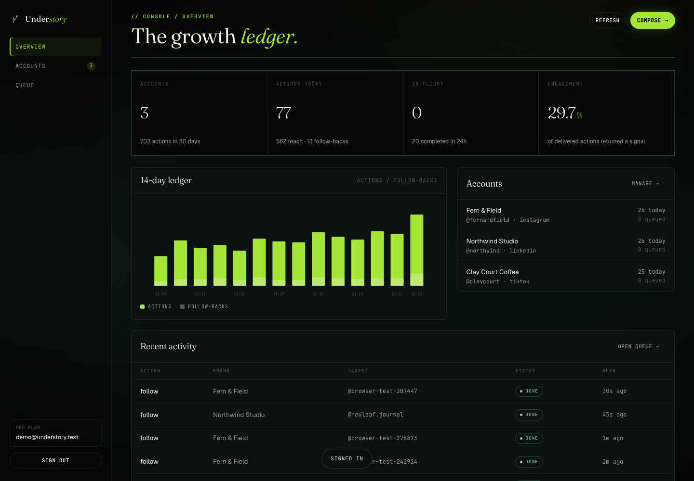
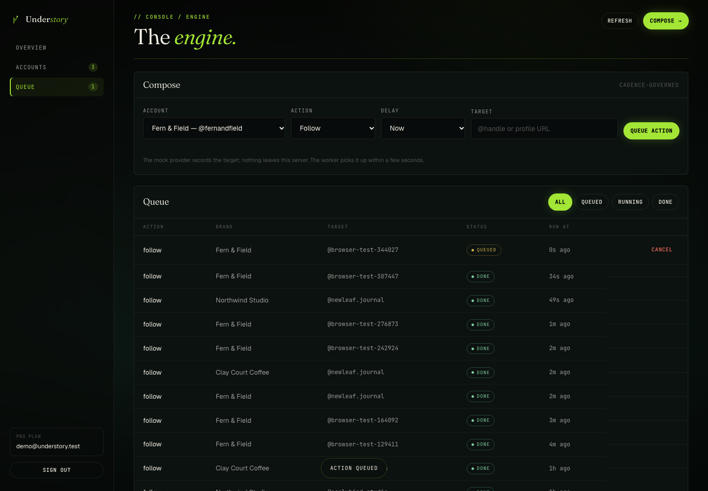
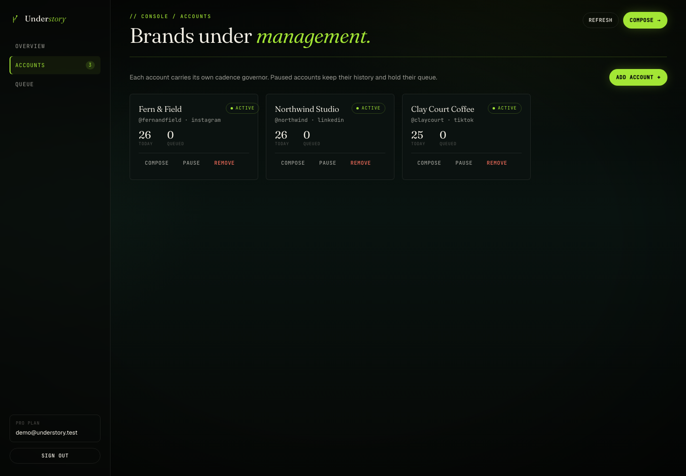

# Understory — console

The working product behind the marketing site: real accounts, real sessions, a
database, multi-brand management, and a scheduler that actually executes queued
work.



Zero dependencies. No `npm install`, no lockfile, no build step — Node 22+ gives
us `node:http`, `node:sqlite` and `node:crypto`, and that's the whole stack.

## Run it

```bash
cd understory-app
node server.js --seed      # seeds a demo account with 14 days of history
# → http://127.0.0.1:8787
```

Demo credentials: **demo@understory.test** / **understory-demo**

Without `--seed` you get an empty database and can register your own account.
`DB_PATH=data/understory.db` and `PORT=8787` are the defaults.

## What actually works

| Area | Behaviour |
| --- | --- |
| Auth | Register, sign in, sign out. scrypt-hashed passwords, opaque session tokens, HttpOnly cookies, 7-day expiry, login throttling |
| Tenancy | Every brand, job and ledger read is scoped by `user_id`; another user's IDs return 404, not 403 (no existence leak) |
| Accounts | Create, rename, pause/resume, delete. Unique per `(user, platform, handle)`. Deleting cascades queue + history |
| Scheduling | Compose follow/like/comment/view against a target, now or delayed; cancel while queued |
| Worker | Runs every 2.5s, picks due jobs, executes them against a mock provider, writes results and ledger rows |
| Cadence governor | Per-brand hourly and daily caps. Over-cap jobs are deferred with a note instead of failing |
| Retries | A provider failure requeues once after 60s, then marks `failed` |
| Crash recovery | Jobs left `running` by a restart are requeued on boot |
| Dashboard | KPIs, 14-day chart, account list, queue with filters, composer, live refresh every 4s |
| Health | `GET /api/health` returns service identity and user count |



## API

All mutating routes require a session cookie. Errors are
`{ error: { code, message } }`.

| Method | Path | Purpose |
| --- | --- | --- |
| `GET` | `/api/health` | Liveness + version |
| `POST` | `/api/auth/register` | `{ email, password }` → 201 + session |
| `POST` | `/api/auth/login` | → 200 + session |
| `POST` | `/api/auth/logout` | Clears session |
| `GET` | `/api/me` | `{ user }` or `{ user: null }` |
| `GET` | `/api/overview` | KPIs, 14-day series, brands, capacity |
| `GET`/`POST` | `/api/brands` | List / create `{ name, handle, platform, timezone }` |
| `PATCH`/`DELETE` | `/api/brands/:id` | Update `{ name?, handle?, status?, maxPerHour?, maxPerDay? }` / remove |
| `GET`/`POST` | `/api/jobs` | List (`?status=&brandId=&limit=`) / create `{ brandId, action, target, delaySeconds \| runAt }` |
| `POST` | `/api/jobs/:id/cancel` | Cancel a queued job |

## Data model

```
users     id, email, password_hash, plan, created_at
sessions  token_hash (PK), user_id, created_at, expires_at
brands    id, user_id, name, handle, platform, timezone, status,
          max_per_hour, max_per_day, created_at
jobs      id, brand_id, action, target, run_at, status, attempts,
          result, note, created_at, finished_at
ledger    id, brand_id, day, actions, engaged, follows, reach   (unique per brand+day)
```

SQLite in WAL mode, foreign keys on, 5s busy timeout. Schema is created on first
boot — there are no migration files because there's nothing to migrate yet.

## Security decisions

- **scrypt** (N=16384, r=8, p=1) with a 16-byte random salt per user, compared
  with `timingSafeEqual`. Params are stored in the hash string so they can be
  raised later.
- **Opaque sessions** — 32 random bytes, only the SHA-256 is stored, so a database
  leak doesn't hand over usable cookies. No JWT, no signing secret to rotate.
- **Cookies** are `HttpOnly; SameSite=Lax; Path=/`, and `Secure` when the request
  arrives over TLS (`x-forwarded-proto` aware).
- **Login throttling**: 10 failures per IP+email per 15 minutes, in memory.
- **CSP** restricts scripts to same-origin, and the app ships no inline script.
  Plus `nosniff`, `X-Frame-Options: DENY`, `Referrer-Policy: same-origin`.
- **Tenant scoping** is applied in the query, not after the fetch.



## Tests

`tests-api.mjs` exercises a live server — 41 assertions covering auth, validation,
tenant isolation, worker execution, cancellation, cadence rejection, overview
aggregates, logout and throttling:

```bash
DB_PATH=data/test.db PORT=8790 node server.js &   # separate db + port
BASE=http://127.0.0.1:8790 node tests-api.mjs     # 41 passed, 0 failed
```

The UI was walked in Chromium: form login → dashboard → accounts → queue →
compose → worker pickup → filter chips → 390px layout, with no console errors.

## Deploy

The Dockerfile is Node-only, runs as `node`, and keeps the database on a volume:

```bash
docker build -t understory .
docker run -p 8787:8787 -v understory-data:/data understory
```

Point `DB_PATH` at a persistent volume on any Node host (Render, Railway, Fly).
**Free tiers usually don't persist disks**, so SQLite resets on redeploy — fine
for a demo, not for real data. For more than one instance you'd need Postgres and
a real job runner; the schema is small enough to port in an afternoon.

## Limits, honestly

- The **provider is mocked**. Jobs are executed against a local simulator with
  realistic success/engagement rates. No social network is contacted, no account
  is logged into, nothing is posted.
- **No email verification or password reset** — there's no mail transport.
- **No billing.** The `plan` column is cosmetic.
- Single-process SQLite; the worker assumes one instance owns the database.
- Registration has no captcha or IP rate limit (only login does) — don't expose
  this publicly without adding one.
